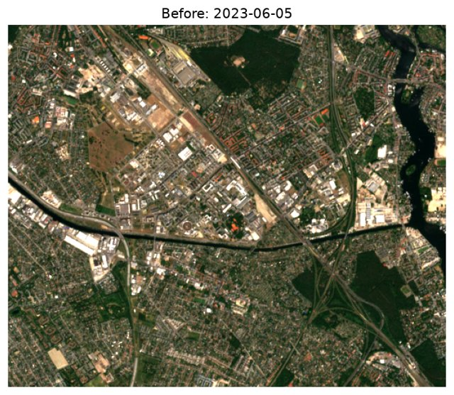
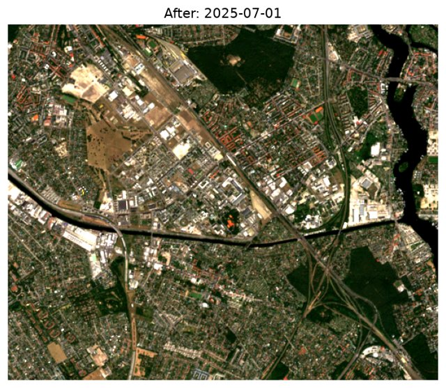
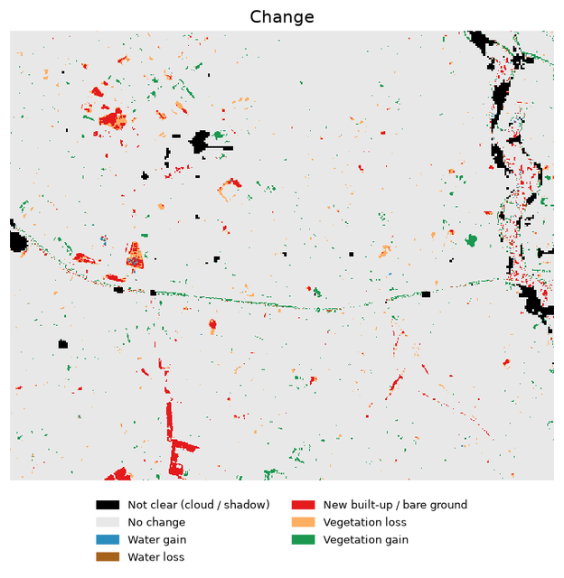

# change-monitor

Measure how a place changed between two dates using free Sentinel-2 satellite imagery: before/after images, a change map, hectares per category, and a short written report. Runs on a laptop CPU, with no account or key needed.

## Example: Berlin-Adlershof, June 2023 → July 2025

| Before | After | Change |
|---|---|---|
|  |  |  |

| Change | Hectares |
|---|---:|
| New built-up / bare ground | 29.65 |
| Vegetation gain | 23.04 |
| Vegetation loss | 19.14 |
| Water loss / gain | 1.90 / 1.17 |

The area is 2,527 ha, 98.6% of it cloud-free on both dates, and 97% unchanged. The red patches are new buildings in the Adlershof science park.

## How it works

1. **Search:** the least-cloudy Sentinel-2 L2A scene per period (STAC, Microsoft Planetary Computer)
2. **Load:** only the pixels in the area, both dates on one 10 m grid, cloudy pixels removed
3. **Measure:** NDVI, NDBI and NDWI differences, then a threshold gives one label per pixel, counted in hectares
4. **Report:** one AI call turns the numbers into text, or a basic report is written by code without a key

Code does all the measuring. The AI only sees the final numbers, never the images.

## Quick start

```bash
uv venv && source .venv/bin/activate
uv pip install -r requirements.txt

streamlit run app.py                   # web app: draw an area on a map
python -m change_monitor.pipeline      # command line (Berlin example; --help for options)
pytest -q                              # offline tests
```

Optional AI report: copy `.env.example` to `.env` and add a key. Gemini has a free tier ([Google AI Studio](https://aistudio.google.com)). Claude is supported too, as is any service using the OpenAI API format (OpenAI, Mistral, Groq, DeepSeek, OpenRouter, or local models with Ollama). With several keys, choose in the app or with `--ai`.

## Limitations

- An estimate from two images and a threshold, not a field survey.
- "Built-up" includes bare ground and construction sites.
- Bright ground (salt flats, sand, snow) can be mistaken for cloud.
- Compare the same season in both periods. Images exist from June 2015.

## Data

Contains modified Copernicus Sentinel data (2016–2025), via the [Microsoft Planetary Computer](https://planetarycomputer.microsoft.com/dataset/sentinel-2-l2a). Map © [OpenStreetMap](https://www.openstreetmap.org/copyright) contributors.
